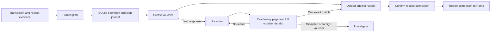

# Frozen postings and uncertain effects

A Ramp transaction, linked original receipt, declared OCR calibration, and configured company binding produce one immutable posting plan. SQLite stores the operation and each recoverable external step. Completion requires all four steps to be confirmed.

The operation key contains Ramp business, entity, transaction ID, and operation type. A database uniqueness constraint prevents duplicate local operations. The exact posting, mapping revision, company identity, transaction version, receipt bytes, and evidence belong to the frozen plan. Apply refreshes evidence before dispatch. A changed plan cannot replace an operation that has started. A completed operation returns its stored result on replay. A pending idempotent acknowledgement tolerates its own SYNCED and transaction-version transition only while every other frozen source and accounting precondition still matches.

## Own each effect separately

Each step has an explicit state. Dispatch commits intent before the HTTP call. A stopped process or ambiguous response leaves the step uncertain. Reconciliation may confirm the effect from full remote evidence. An absent voucher never grants permission to resend its POST.

A confirmed voucher remains the same voucher while upload, connection, or acknowledgement is repaired. Before each Ramp acknowledgement, the connector reads the full voucher, hashes the uploaded original, and verifies the exact year, series, number, and file connection again. Changed evidence requires investigation. The report uses a stable idempotency key and unchanged request.

A whole-dispatch process lock protects one canonical local SQLite database. Competing processes cannot steal an active dispatch or confuse a live request with a crashed owner. SQLite also makes operation registration and dispatch claims atomic. This guarantee applies to one local host and ledger. Copies of the database and independently operated connectors are outside it.

## Detect uncertainty instead of hiding it

The owned voucher series is a convention. Before creation, inspect the series and record its last voucher number. Reconciliation still scans every page and reads full details. An unknown operation marker, duplicate marker, or changed posting requires investigation. `Manual=false` and the previous last number do not prove exclusivity or non-execution.

The fixture services explicitly model definitive rejections and readback evidence. Those semantics do not establish Fortnox retry guarantees. Live upload and connection recovery require pinned vendor contracts before any adapter can use them.

## Design choice

Two independent candidates compared direct operation/step storage with an append-only event reducer. An independent judge preferred the direct journal because its stored states match the four P0 effects. Event replay and projection rebuilding added maintenance without a requirement that needed them. The chosen design retains durable attempts and takes the event candidate's whole-dispatch lock.

OCR `tax_amount` is accepted as explicit receipt-derived Ramp evidence only with declared units and matching original receipt evidence. Requiring a second transaction-level VAT field would contradict the supported source. The arithmetic check validates the supplied VAT amount. It never creates missing VAT.

The important open boundary is provider proof. The architecture explains local behavior under declared faults. [Sandbox gates](sandbox-gates.md) define what remains before a live adapter or interoperability claim.

## Read-only assessment

The verifier receives an atomic read-only snapshot of selected frozen plans before collecting target observations. It branches before the writable journal and connector constructors. It compares the expected population independently of dispatch success. It captures observation coverage and raw evidence for offline replay. It never changes a step or authorizes a retry. See [verification](verification.md) for the population boundary and five report classifications.

## PostgreSQL sandbox service

The TypeScript service retains the Python reference and its independent posting oracle. PostgreSQL owns unique source actions, immutable encrypted plans and requests, token bindings, and four durable step outcomes. A dedicated session holds the target/year/series dispatch lock. Effect owns typed failure and resource lifetimes. Provider adapters preserve endpoint-specific semantics; they do not share a universal accounting interface. See the [service guide](sandbox-service.md) for proof commands, capabilities and the missing actual-provider gate. The read-only verification command above still uses the Python fixture ledger.
